<p align="center"></p>

# 🚀 Kodometer 0.8.0

## ✨ Highlights

Kodometer 0.8.0 adds month-to-date cached-input percentage to the OpenAI API tab and removes the unavailable credit-balance placeholder and explanatory footnotes. Release notes now use the centered brand-pack logo above the title, matching the Kairos release-header layout.

This is a minor release after 0.7.0 because `feat(openai): show month-to-date cached input percentage` adds a user-visible metric and an optional Usage API request. The accompanying `fix(ui)`, `docs(release)`, and `test(release)` commits simplify presentation and support the branded notes. `git-cliff --bumped-version` selects `v0.8.0`. There are no deliberate breaking changes, new credentials, or configuration/storage migrations. Existing OpenAI profile selections, Admin keys, preferences, and quota history remain intact.

## 🚀 Features

- The OpenAI API tab displays **Cached input (month to date): N.N%** when valid usage data is available. It divides summed `input_cached_tokens` by summed `input_tokens` across reported daily UTC buckets in the current month. This is the share of input tokens served from cache, not the percentage of requests with a cache hit, and not an average of daily percentages.
- The widget uses the official `GET /v1/organization/usage/completions` endpoint after a successful Costs response, with the same pinned organization Admin key. Existing API setups need no additional setting or credential. Usage is organization-wide and independent of the selected subscription profile.
- Nonzero input with zero cached tokens displays 0.0%. Zero input, missing permissions, invalid or incomplete usage responses, and request failures omit the metric without hiding valid spending. Each refresh replaces the prior usage result; a failed optional request cannot retain an old percentage alongside new spending.
- Release overviews now start with the existing iris-on-dark brand asset. The image URL is pinned to the release tag. Historical published notes are unchanged.

The existing Plan/API tab switch remains enabled by default; turning it off still stacks the sections. No new chart, billing-history persistence, dependency, or background request outside the normal refresh cycle is introduced.

## 🐛 Fixes

- Remove the OpenAI API credit-balance placeholder. The supported public API does not expose prepaid credit balance, and reported spending is not used to infer it.
- Remove the organization-spending disclaimer and partial-history/current-day footnotes from the OpenAI API page. Spending totals, the daily chart, range controls, and selected-day values remain. Missing days are still unknown rather than zero; other providers retain their existing history notes.
- Validate complete, ungrouped daily Usage pages before publishing a percentage. Duplicate buckets, partial pagination, malformed bounds, negative or fractional counts, cached counts exceeding input, and unsafe aggregate totals cannot become a plausible cache percentage.

## 📦 Packages

The inventory comes from `packaging/targets.json` and `scripts/package_metadata.py`. Each native package is built against its target distribution's libraries; DEB/RPM payloads do not reuse Arch binaries.

| Distribution / purpose | Architecture | File |
| --- | --- | --- |
| Arch Linux (rolling), native package | x86_64 | `kodometer-0.8.0-1-x86_64.pkg.tar.zst` |
| Ubuntu 26.04 LTS, native package | amd64 | `kodometer_0.8.0-1ubuntu26.04_amd64.deb` |
| Fedora 43, native package | x86_64 | `kodometer-0.8.0-1.fc43.x86_64.rpm` |
| Fedora 44, native package | x86_64 | `kodometer-0.8.0-1.fc44.x86_64.rpm` |
| Arch Linux (rolling), legacy binary archive | x86_64 | `kodometer-0.8.0-linux-x86_64.tar.gz` |
| Arch Linux (rolling), AUR source recipes | x86_64 target | `kodometer-0.8.0-aur.tar.gz` |
| Source for local builds on compatible Linux | Released targets: x64 | `kodometer-0.8.0-source.tar.gz` |

Each payload has an individual `.sha256` sidecar. `kodometer-0.8.0-SHA256SUMS` lists all seven payloads, for 15 uploaded files total. Use the explicit source archive for source-recipe builds, not GitHub's automatic source downloads. The legacy archive is Arch-built and has no package-manager dependency protection.

The public AUR RPC returned no `kodometer` entry on 2026-11-03 UTC. Repository configuration has no enabled `AUR_PUBLISH_ENABLED` flag and no dedicated AUR publication secrets. The recipe bundle supports local builds; this release does not claim a live AUR package.

## 🛠️ Installation and upgrade

Download the package and checksum for your distribution from this release. Log out of Plasma before replacing the loaded plugin. Install from a TTY or SSH session, then log back in.

```sh
# Arch Linux, matching the package's Plasma minor-series bounds
sha256sum -c kodometer-0.8.0-1-x86_64.pkg.tar.zst.sha256
sudo pacman -U ./kodometer-0.8.0-1-x86_64.pkg.tar.zst

# Ubuntu 26.04 LTS
sha256sum -c kodometer_0.8.0-1ubuntu26.04_amd64.deb.sha256
sudo apt install ./kodometer_0.8.0-1ubuntu26.04_amd64.deb

# Fedora 43
sha256sum -c kodometer-0.8.0-1.fc43.x86_64.rpm.sha256
sudo dnf install ./kodometer-0.8.0-1.fc43.x86_64.rpm

# Fedora 44
sha256sum -c kodometer-0.8.0-1.fc44.x86_64.rpm.sha256
sudo dnf install ./kodometer-0.8.0-1.fc44.x86_64.rpm
```

Use the same installation method and prefix. Remove manual system or user-local duplicates before switching to a native package; do not overwrite a package-managed plugin with `cmake --install`. Packages do not delete credentials, KWallet entries, preferences, or quota history. Upgrading from 0.7.0 requires no migration or sign-in reset. The existing Admin key is reused for the optional cache metric; ordinary project keys and subscription OAuth credentials are not organization billing credentials.

If no binary matches your Plasma minor series, review and build the source recipe as a normal user against your installed libraries. Build before logging out, then install while Plasma is stopped. Never force incompatible dependencies or symlink different Plasma SONAMEs together. See the [0.8.0 package guide](https://github.com/kyaulabs/kodometer/blob/v0.8.0/docs/packaging.md) and [tagged source-build instructions](https://github.com/kyaulabs/kodometer/blob/v0.8.0/README.md#build-and-install). Container provisioning helpers are not desktop installers.

## ⚠️ Compatibility and known limitations

- Source builds require Plasma/libplasma 6.4+, Qt 6.4+, and KDE Frameworks 6. Arch binaries remain bounded to their build's Plasma minor series. Binary packages must match their distribution's Qt/KDE libraries; no libraries are bundled and one plugin does not span incompatible SONAMEs.
- Release packages target x64 Arch rolling, Ubuntu 26.04 LTS, and Fedora 43/44. There are no ARM, generic Debian, or RHEL packages. Ubuntu 24.04's standard Plasma stack is too old. There is no hosted APT/DNF repository or automatic desktop updater.
- OpenAI Costs and Usage are reported organization-wide data and may be delayed. The cache percentage covers the current UTC month, including its incomplete current day, not the chart's selected 7-day/30-day range. Missing reports are not fabricated. Usage permissions can be unavailable even when Costs works; the percentage is then omitted.
- This release adds no prepaid credit balance, project filter, named API organization accounts, or request-level cache hit rate. Subscription quotas and other providers' authentication contracts remain unchanged. See the [tagged provider documentation](https://github.com/kyaulabs/kodometer/blob/v0.8.0/README.md).

## 🔒 Security and privacy

The Admin key remains in KWallet or the process environment. Both requests pin the originating key, use fixed official HTTPS destinations, disable redirects, and bound each response to 1 MiB with a 15-second timeout. The controller publishes the combined result under its existing context revision, so changed-key or stale results cannot cross account contexts. No credential enters QML metadata, Plasma settings, logs, notifications, or browser URLs. No provider CLI, browser session, or private dashboard endpoint is accessed.

API billing/usage results remain transient. Subscription quota-history ownership, retention, and authenticated restore rules are unchanged. There are no new dependencies or separate security-advisory fixes in this release.

Published assets are immutable. SHA-256 checks detect corruption but do not establish publisher identity. Publication creates an annotated source tag, not an independently GPG-signed tag, and does not independently sign DEB/RPM payloads. Reviewed development commits retain their GPG signatures through merge commits.

## ✅ Validation

Release approval is gated on version agreement across CMake, applet metadata, and package metadata; release-note schema/inventory checks; actual combined overview/git-cliff preview; native Debug tests; fresh Release tests for all four distribution targets; separate clean-runtime install/reinstall/startup checks; and the complete candidate payload/checksum inventory. Formatting, compiled QML lint, ShellCheck, Actionlint, offline Python automation, commit lint, Gitleaks, dependency review, and all three unchanged 96% coverage gates must pass on the reviewed head. Performed results are recorded in the release PR rather than assumed from an earlier build.

Publication rebuilds the exact merged revision, verifies the annotated tag target, downloads every draft payload and checksum, and compares bytes with its inputs before publishing. Validation uses synthetic credentials, local fake servers, and isolated/offscreen sessions. No live OpenAI billing request, cache-efficiency claim for a real account, or replacement of the owner's desktop plugin is claimed.
